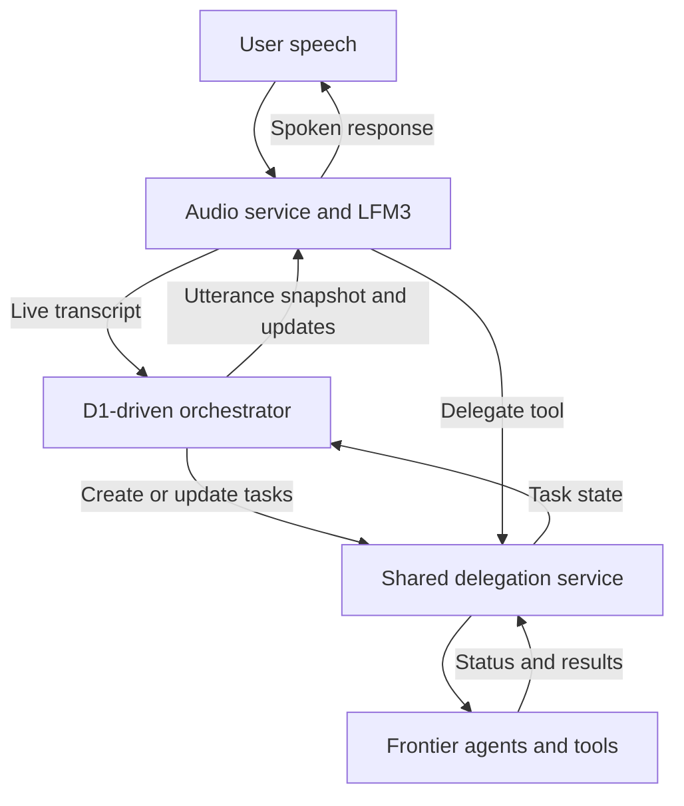

# T3 Voice Assistant — Architecture and Implementation Plan

**Status:** Design proposal, not a description of an implemented system  
**Source:** The recent discussion about LFM3 audio, a D1-driven orchestrator, frontier delegation, and a possible T3 Code fork  
**Updated:** November 15, 2026

## 1. Goal

Build a responsive, conversational voice assistant that can understand and speak naturally while substantial work happens through a separate agentic system. From the user's perspective, interacting with a frontier-capable assistant should feel like a single conversation, even when work is delegated behind the scenes.

The design separates the voice and personality layer from the system that identifies tasks, manages their execution, and coordinates more capable models. A single spoken turn can contain several requests, corrections, dependencies, or a change of topic; the system should handle these as the user speaks instead of waiting to treat the entire turn as one indivisible instruction.

## 2. Decisions and direction from the discussion

- **Voice layer:** LFM3 Audio 2B is the leading candidate for the real-time speech interface and conversational personality. A CPU-only VPS running the model at full precision was explored; actual suitability, latency, and cost remain to be measured.
- **Orchestration:** A separately hosted decision model, such as D1-2B, drives an orchestrator that receives the live transcript. The orchestrator is authoritative for task segmentation and delegation.
- **Substantive work:** Frontier agents carry out most substantive tasks. The exact provider, model, execution environment, and tools remain open.
- **Shared delegation:** Tasks detected by the D1-driven orchestrator and tasks requested through the voice assistant's delegate tool enter the same delegation pathway. Both paths report status through the same task record.
- **Feedback:** At the end of an utterance, provide the voice assistant with a single deterministically constructed message describing what the orchestrator has identified and the current state of its tasks. Later updates may be delivered as tasks progress or finish.
- **Foundation:** Investigate a fork of T3 Code as the agent-side foundation. This is a proposed direction, not a commitment or proof that its current implementation supports every requirement.

## 3. Architecture



The diagram describes logical roles, not a fixed deployment topology. In particular, whether LFM3 exposes a suitable simultaneous transcription and speech-generation interface, and how tool results can be injected into its live session, must be verified against the actual runtime.

### Components

**Audio and voice service**

- Accepts microphone audio, manages the real-time session, and streams audio back to the client.
- Hosts or connects to LFM3 Audio 2B for speech understanding, conversational responses, and voice generation.
- Exposes incremental transcription to the orchestrator, if the selected model and serving stack support it. If they do not, evaluate a separate streaming ASR path; do not assume it comes for free from the model.
- Handles turn detection, interruptions, cancellation of stale speech, and the timing of incoming orchestration messages.
- Makes a `delegate` tool available to the voice model. The tool submits to the shared task service rather than creating a separate execution system.

**D1-driven orchestration service**

- Receives a stream of partial and finalized transcript updates, along with turn identifiers and revisions.
- Uses the decision model and deterministic application logic to identify possible task boundaries, classify intent, track corrections and dependencies, and decide when to submit work.
- Maintains the authoritative view of task segmentation and delegation. The model's suggestions are interpreted and validated by the surrounding service; the precise decision schema is still open.
- Produces the end-of-utterance snapshot from recorded task state, not from an unconstrained summary of what the system hopes happened.

**Shared delegation and task service**

- Provides one interface for requests from both the orchestrator and the voice model's tool call.
- Assigns task IDs, tracks state, routes work to frontier agents, and accepts progress, result, failure, and cancellation events.
- Deduplicates overlapping submissions and makes retries safe. Similar wording alone should not automatically merge distinct requests; a user may intentionally repeat an action.
- Preserves links among conversation, utterance, transcript span, task, dependency, execution attempt, and result where available.

**Frontier execution**

- Runs the delegated task using an appropriate agent, model, and available tools.
- Returns structured state changes and results to the shared task service, including failure or uncertainty.
- May outlive the utterance that started it; task completion must not depend on the user continuing to speak.

**Client**

- Captures and plays audio, displays or otherwise exposes connection and task state, and supports interruption.
- The initial client platform and interface are undecided. T3 Code's existing interface is a possible starting point, subject to investigation.

## 4. Turn and task lifecycle

1. **Begin a turn.** The audio service starts or continues a session and associates incoming speech with a conversation and utterance ID.
2. **Stream recognition.** Partial transcript revisions are sent to the orchestrator as they become available. Updates may revise previous words; a partial transcript is not final truth.
3. **Interpret incrementally.** The orchestrator evaluates the evolving transcript for distinct requests, changes of subject, corrections, and dependencies. It may wait for more context when a segment is incomplete or ambiguous.
4. **Dispatch when appropriate.** A sufficiently clear, actionable request can be submitted before the user finishes speaking. Work that depends on another task or on clarification stays pending. Early dispatch is a goal to evaluate, not a requirement to act on every tentative phrase.
5. **Reconcile revisions.** If the user corrects a request, the orchestrator updates its task record. Depending on the work's state and nature, it can revise, cancel, supersede, or ask for clarification; it must not assume a dispatched operation can always be undone.
6. **Finish the utterance.** When the turn is finalized, the orchestrator reconciles final transcript and task records and constructs one `utterance_snapshot` for the voice assistant.
7. **Continue asynchronously.** The voice assistant responds based on the snapshot. Subsequent task updates can be surfaced when useful, including after the user has started another turn. Running or pending work is described as such; only completed work is presented as complete.

The voice model can also explicitly invoke its delegate tool. That request goes through the same task service and must be reconciled with any matching orchestrator-created request to avoid duplicate work.

## 5. Illustrative message contracts

These examples are proposed shapes for discussion, not an existing API. Identifiers and field names can change during implementation.

### Transcript update

```json
{
  "type": "transcript_update",
  "conversation_id": "conv_123",
  "utterance_id": "utt_456",
  "revision": 3,
  "text": "Find the report and summarize it",
  "is_final": false
}
```

Revision numbers allow the receiver to discard out-of-order updates. A production design needs a clear contract for whether `text` replaces the whole utterance or contains a delta; start with whole-utterance replacement for clarity.

### Shared task request

```json
{
  "type": "task_request",
  "conversation_id": "conv_123",
  "utterance_id": "utt_456",
  "source": "orchestrator",
  "request_id": "req_789",
  "instruction": "Find the report",
  "depends_on": []
}
```

`request_id` can make retries of the *same request* idempotent. Cross-source deduplication requires explicit reconciliation logic and cannot be guaranteed merely by issuing an ID.

### End-of-utterance snapshot

```json
{
  "type": "utterance_snapshot",
  "conversation_id": "conv_123",
  "utterance_id": "utt_456",
  "final_transcript": "Find the report and summarize it.",
  "tasks": [
    {"task_id": "task_1", "description": "Find the report", "status": "running"},
    {"task_id": "task_2", "description": "Summarize the report", "status": "pending", "depends_on": ["task_1"]}
  ],
  "clarification_needed": null
}
```

Construct this deterministically from the final transcript and task records. Include completed results only when available and appropriate for the voice context. This is a status snapshot, not a command for the voice model to invent a success.

### Later update

```json
{
  "type": "task_update",
  "conversation_id": "conv_123",
  "task_id": "task_1",
  "status": "completed",
  "result_summary": "The report was found."
}
```

An update is optional and event-driven. The delivery policy—immediately spoken, buffered, displayed, or folded into a later response—needs testing, especially during an active user utterance.

## 6. T3 Code investigation

The previous discussion identified T3 Code as a possible agent-side base, potentially useful for task lifecycle, provider delegation, cancellation, and communication interfaces. Treat these as **capabilities to inspect and verify in the chosen version**, not as guarantees of available APIs or easy reuse.

1. Inspect the repository, license, architecture, current orchestration design, and provider interfaces.
2. Check whether a task can be created outside an active parent agent run, remain alive across voice turns, and report progress independently. The active-parent-run constraint raised in the discussion is an investigation item, not an established limitation.
3. Determine whether its task and conversation model can express general assistant work without forcing a coding-session abstraction onto every request.
4. Identify the actual extensibility points for task submission, status, cancellation, event streaming, and any RPC or MCP interfaces. Verify which are implemented versus merely possible.
5. Prototype a `VoiceOrchestrationService` around the shared task pathway. Keep the real-time audio service separate initially so audio transport, inference, and timing can evolve independently of the agent runtime.
6. Decide whether a fork, adapter, or separate service is appropriate after the spike. Record the maintenance burden and version used.

A T3 Code foundation would not eliminate the need to build or integrate streaming audio, speech activity and turn detection, interruption handling, synchronization, transcription, and the voice-model session protocol.

## 7. Implementation stages

### Stage 1 — Validate the speech path

- Identify the exact LFM3 Audio 2B model and runtime, and verify input/output streaming, incremental transcript availability, tool calling, and whether structured messages or tool results can be inserted during an active voice session.
- Benchmark a CPU-only VPS at the intended precision with realistic concurrent audio workloads. Measure time to first transcript, transcript update cadence, time to first audio, real-time factor, CPU/RAM use, and behavior during interruptions.
- Measure the complete path including network delay, rather than equating model inference speed with conversational latency. Price the actual tested VPS and remote model separately when choosing a provider.
- **Exit:** A reproducible demo or a clear finding about which parts require a different runtime or separate ASR.

### Stage 2 — Prototype segmentation

- Feed recorded and live incremental transcripts to the remote D1-driven orchestrator.
- Define a minimal decision contract for candidate task boundaries, dependencies, ambiguity, correction, and dispatch readiness.
- Test multiple requests in one utterance, mid-sentence changes, transcript revisions, corrections, and sentences that describe a task without requesting it.
- **Exit:** Inspectable task records that reflect the final request without routinely dispatching duplicates or acting on unstable fragments.

### Stage 3 — Build the shared task pathway

- Add task creation, state transitions, event history, idempotent retries, dependencies, cancellation requests, and a mock frontier worker.
- Connect both orchestration-driven submissions and the voice assistant's delegate tool to this pathway.
- Build deterministic snapshots and test overlap between the two sources.
- **Exit:** One task lifecycle is visible from creation through completion or failure, even if initiated from either path.

### Stage 4 — Connect frontier execution

- Route tasks to a frontier agent with a bounded tool set and return progress and results to the task service.
- Exercise long-running work, failures, retries, dependencies, cancellation, and tasks that finish after the originating voice turn.
- **Exit:** A complete voice-to-task-to-result loop with accurate spoken status.

### Stage 5 — T3 Code integration and user experience

- Run the repository investigation and choose the appropriate integration boundary; the investigation can begin earlier in parallel with the prototype.
- Add a minimal client and refine barge-in, reconnection, event ordering, and when updates are spoken.
- Test against real conversational sessions and use measurements to choose the hosting arrangement.
- **Exit:** A usable end-to-end prototype and a documented decision about whether to fork T3 Code.

## 8. Evaluation and failure cases

Track timestamps across microphone input, transcript revisions, orchestration decisions, task dispatch, frontier events, snapshot delivery, and first spoken response. Measure median and tail latency, task segmentation accuracy, duplicate dispatches, premature dispatches, missed corrections, transcription errors, task completion/failure, interruption responsiveness, and cost per conversation or hour. Choose quantitative targets after an initial baseline.

Test at least these scenarios:

- Two independent requests in one utterance; two dependent requests; a topic change.
- A correction after a partial transcript or early dispatch.
- The voice model and orchestrator both attempting to delegate the same task.
- A task completing after the end-of-utterance snapshot, or while the user is speaking again.
- Model, network, or worker failure; retry after an uncertain acknowledgement.
- A request whose execution has an external side effect: do not treat cancellation or a corrected transcript as proof the side effect was reversed. The action policy and confirmation behavior need explicit design.
- User interrupts generated speech and asks a follow-up while previous work is still running.

Store enough correlated event history to diagnose what happened. Retention, privacy controls, and whether raw audio is stored remain open product decisions.

## 9. Open questions

- Can the selected LFM3 runtime supply usable live transcription before response generation while simultaneously supporting the desired audio interaction? Can it accept structured task updates at the required points?
- What actual latency and monthly cost does a full-precision CPU deployment deliver under the intended workload? How many simultaneous sessions are needed?
- What is the remote D1 model's decision interface, latency, and hosting arrangement? How frequently should transcript updates trigger decisions?
- Which task classes are safe and useful to dispatch on partial speech, and when should the system wait for finalization or clarification?
- How will duplicate detection distinguish two paths submitting the same intent from a user intentionally repeating a request?
- How should an in-flight task be changed or canceled when a transcript is revised? What happens when a side effect has already occurred?
- How should later results reach the voice model without interrupting or contradicting an active conversation?
- Which frontier models, tools, and execution environments will be used, and what permissions do they receive?
- Does the chosen version of T3 Code support the required task lifetime and integration model, and is a fork justified?
- What client, deployment, persistence, privacy, and access-control choices fit the first release?
