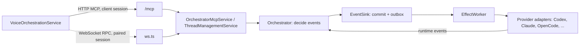

# T3 Code as the voice assistant's delegation base

This document answers [plan](plan.md) section 6, items 1 to 4 and 6. It covers what T3 Code implements today, what an outside `VoiceOrchestrationService` can reach, and whether to fork, adapt, or build a separate service.

**Bottom line.** Build an adapter. A voice service that runs outside T3 can already submit, follow, steer, and stop work through T3's MCP endpoint, so no patch to upstream files is needed for the delegation pathway. Use top-level threads as the unit of work, not `delegate_task`. `delegate_task` needs an active parent agent run, and both the MCP layer and the orchestrator core enforce that rule. The one real gap is push events for outside MCP clients. Outside clients must poll or block on a wait, or use the WebSocket RPC streams.

## Versions and evidence

- **Cited commit.** Every `path:line` citation in this document is at this fork's `main`, commit `eeae88de5c68b2d3c744ad5e7e4964e118856d3f`, which mirrored upstream `main` on 2026-11-15. `voice/tools/check_citations.py` moved each citation from the installed build to this commit and flagged each one whose code changed. Each flagged claim was then re-read at `eeae88de5` (measured).
- **Upstream repository.** `pingdotgg/t3code` on GitHub, MIT license, default branch `main` (measured with the GitHub API on 2026-11-15).
- **Installed app.** The investigation ran against `T3 Code (Nightly)` version `0.1.8-nightly.20261106.4275`, built from commit `6577c6b6185167c0e502fa01f9e8e8f2dee6ff25`, committed 2026-11-06. The version and commit come from the `buildVersion` and `t3codeCommitHash` fields of `package.json` in `resources/app.asar`, from `~/.t3/userdata/desktop-last-started-version`, and from the GitHub API (measured).
- **Gap between the two.** `eeae88de5` is 2,268 commits ahead of `6577c6b6` (measured, `git rev-list --count` and the GitHub compare API). The findings hold at both commits. Three details differ at `eeae88de5` (measured):
  - `t3_thread_send` is still a `writesThreads` tool. It is now wrapped in `afterForwarding`, which adds a step for calls that a linked environment answers (`apps/server/src/mcp/toolkits/orchestrator/handlers.ts:176-193`).
  - A sign-in that reaches the environment through T3 Connect can be approved on the T3 Code web app without a pairing code (`docs/user/outside-agents.md:53-70`).
  - The MCP server now sends `notifications/tools/list_changed`. It still sends no thread progress (`apps/server/src/mcp/McpHttpServer.ts:1358-1368`).
- **Live tool surface.** I called `orchestrator_capabilities`, `t3_project_list`, and `t3_thread_list` from an agent thread in the installed app. Those results are labeled "measured, live" and describe the installed build, not `eeae88de5`.

## Overview

T3 Code is an Electron, web, and mobile client over a Node server. The server wraps provider agent CLIs and SDKs (Codex, Claude Agent SDK, Cursor, Grok, OpenCode, Pi, Muse Code, fx, Antigravity, Kiro, generic ACP agents) behind one orchestration model (`AGENTS.md:3`, `docs/internals/adding-a-provider.md:8-17`). Clients talk to the server over a typed WebSocket RPC. Agents and outside tools talk to it over an authenticated HTTP MCP endpoint at `/mcp` (`apps/server/src/mcp/McpHttpServer.ts:1334`, `apps/server/src/httpCors.ts:16`).

For the voice assistant, the useful part is the orchestration server, not the UI. It persists threads and runs in SQLite, runs provider agents on the user's existing subscriptions, and already exposes submit, read, wait, steer, interrupt, and schedule operations to callers outside the app. It does not model utterances, transcript spans, cross-source deduplication, or task dependencies. The voice service has to own those.

## Key concepts

- **Project.** An environment-local record rooted at a directory (`AGENTS.md` glossary, `docs/orchestration-v2/core-graph-and-data-model.md:7-15`). Every thread belongs to one.
- **AppThread.** The durable conversation. It has `projectId`, model selection, runtime and interaction modes, and nullable `branch` and `worktreePath` (`docs/orchestration-v2/core-graph-and-data-model.md:143-161`).
- **Run.** One counted turn on a thread. Status is one of `queued`, `starting`, `running`, `waiting`, `completed`, `interrupted`, `failed`, `cancelled`, or `rolled_back` (`docs/orchestration-v2/core-graph-and-data-model.md:181-211`).
- **Delegated task.** A child thread that `delegate_task` creates under a parent run's execution node, with `subagent` lineage. The `delegated_task.request` command requires `parentThreadId`, `parentRunId`, and `parentNodeId` (`packages/contracts/src/orchestrationV2.ts:3527-3542`).
- **MCP caller kinds.** A thread caller is an agent that T3 started, with a provider-session credential. A client caller is anything else that signed in with OAuth or a host-issued session. Its `thread` is `undefined` (`apps/server/src/mcp/McpInvocationContext.ts:27-53`, `apps/server/src/auth/McpOAuth.ts:626`).
- **Access levels.** A client caller is approved as `read-only`, `approval-required`, `auto-accept-edits`, `auto`, or `full-access` (`packages/contracts/src/auth.ts:258-264`). Threads it starts cannot run above that ceiling (`docs/user/outside-agents.md:72-81`).

## How it works

### Command flow inside the server

A client request or MCP tool call becomes an orchestration command. The orchestrator serializes commands and decides events without doing I/O. `EventSink` commits events, projections, the command receipt, and outbox effects in one transaction. The effect worker then runs side effects, such as starting a provider turn, and feeds results back as commands (`AGENTS.md` "How it works", `docs/internals/overview.md:45-59`). A command acknowledgement means the intent committed, not that the agent finished (`docs/internals/overview.md:56-58`).

### Two caller kinds, two sets of tools

The MCP auth middleware first tries the token as a provider-session credential, then as an outside client session (`apps/server/src/mcp/McpHttpServer.ts:252-255`). An outside client gets the `orchestration`, `worktree`, and `pull-requests` capabilities and no thread (`apps/server/src/auth/McpOAuth.ts:604-642`).

Each tool declares an access rule (`apps/server/src/mcp/toolkits/orchestrator/handlers.ts:16-239`). `actsAsCaller` tools first require a thread caller and fail with `thread_credential_required` for outside clients (`apps/server/src/mcp/McpToolAccess.ts:140-161`, `apps/server/src/mcp/McpInvocationContext.ts:247-258`). Those tools are `delegate_task`, `task_status`, `task_cancel`, `create_threads`, `request_secret`, and `t3_background_wait`. The `reads`, `writesThreads`, `startsThreads`, and `writes` rules accept outside clients and refuse only `read-only` ones for writes (`apps/server/src/mcp/McpToolAccess.ts:116-128`, `:199-283`). Those tools include `t3_thread_launch`, `t3_thread_send`, `t3_thread_read`, `t3_thread_wait`, `t3_thread_interrupt`, `t3_thread_list`, and `schedule_task`.

### How an outside process signs in

There are two paths, both implemented.

1. **OAuth.** Any MCP client with HTTP OAuth support can register dynamically, open the sign-in page, and get approved (`docs/user/outside-agents.md:53-81`, `apps/server/src/auth/McpOAuth.ts:93-104`). On the environment's own page, approval takes a pairing code. A sign-in that comes through T3 Connect can instead be approved on the T3 Code web app without a code. Sign-in works over `localhost` or `https`, not plain LAN `http` (`docs/user/outside-agents.md:42-48`). A sign-in lasts 30 days (`docs/user/outside-agents.md:164`).
2. **Host-issued session.** The bundled `t3 thread` CLI calls `EnvironmentAuth.issueMcpClientSession` with `access: "full-access"`, uses the token against `/mcp`, and revokes it on exit (`apps/server/src/cli/thread.ts:218-249`). On Windows the installed app puts this CLI at `~/.t3/bin/t3.cmd`, which runs `apps/server/dist/bin.mjs` from `server.asar` (measured on the installed build). `t3 thread list`, `start`, `send --wait`, and `show` wrap `t3_thread_list`, `t3_thread_launch`, `t3_thread_send` with `t3_thread_wait`, and `t3_thread_read` (`apps/server/src/cli/thread.ts:742-952`, `docs/user/outside-agents.md:138-158`).

### Launching work without a parent run

`t3_thread_launch` from an outside client needs `projectId` or `scratch: true` (`apps/server/src/mcp/toolkits/project/tools.ts:129-145`). `scratch: true` creates a folder in the environment's Scratch project (`apps/server/src/mcp/toolkits/project/handlers.ts:132-153`). With no calling thread to inherit from, the launch uses the project's default model and modes, capped by the client's approved ceiling (`apps/server/src/mcp/toolkits/project/handlers.ts:226-258`). The same `clientRequestId` replays an accepted launch instead of starting a second one (`apps/server/src/mcp/toolkits/project/handlers.ts:117-125`).

## Answers to the plan's questions

### 1. License, architecture, orchestration design, and provider interfaces

- **License.** MIT, copyright 2026 T3 Tools Inc. (`LICENSE:1-3`). The installed app's `package.json` also states MIT (measured, `app.asar`).
- **Architecture.** The server owns provider processes, terminals, git, and files. Clients control it over authenticated RPC (`docs/internals/overview.md:3-14`). It is event-sourced, as described in "Command flow inside the server".
- **Orchestration.** `apps/server/src/orchestration-v2/Orchestrator.ts` (16,448 lines) decides events. `ThreadManagementService` is the shared application boundary for WebSocket commands and MCP (`docs/orchestration-v2/orchestrator-mcp-server.md:23-28`).
- **Provider interface.** Native adapters implement `ProviderAdapterV2` (`packages/provider-core/src/server/ProviderAdapter.ts`). Its session runtime exposes an `events` stream and `startTurn`, `steerTurn`, `interruptTurn`, `ensureThread`, and `resumeThread`, plus optional subagent and background-task hooks (`packages/provider-core/src/server/ProviderAdapter.ts:698-809`). ACP agents reuse one shared adapter (`docs/internals/adding-a-provider.md:10-14`). Live, Codex, Claude, OpenCode, Antigravity, Muse, and an ACP registry agent could run child tasks on the test machine. Cursor, Grok, fx, Kiro, and Pi were disabled there (measured, live `orchestrator_capabilities`).

### 2. Can a task start outside an active parent run, live across voice turns, and report progress on its own?

It depends on which entity "task" means. I tested the premise in the code instead of assuming it.

- **As a `delegate_task`, no.** The MCP service refuses unless the caller's newest active run belongs to its provider session (`apps/server/src/mcp/OrchestratorMcpService.ts:2665-2676`). The orchestrator core enforces the rule again for any `delegated_task.request`, including one sent over WebSocket `dispatchCommand`. It fails with `Parent run ... is not active` (`apps/server/src/orchestration-v2/Orchestrator.ts:9387-9396`). The installed build has the same rule (measured). Outside clients cannot call `delegate_task` at all (see "Two caller kinds").
- **As a top-level thread, yes.** `t3_thread_launch`, `t3 thread start`, and WebSocket `orchestration.launchThread` have no parent-run requirement (`apps/server/src/mcp/toolkits/project/handlers.ts:110-329`, `packages/contracts/src/rpc.ts:1947-1951`). `schedule_task` also starts runs "even when no turn is active", on an interval, a fixed time, or a webhook (`docs/orchestration-v2/orchestrator-mcp-server.md:463-477`).
- **Lifetime across turns.** Threads and runs are durable SQLite projections (`docs/internals/overview.md:45-53`). Even delegated children outlive the run that spawned them. When the parent run has ended, the orchestrator queues a parent turn that tells the agent to call `task_status` (`apps/server/src/orchestration-v2/Orchestrator.ts:14132-14135`, `:2113-2124`, `apps/server/src/orchestration-v2/ProviderContinuationService.ts:20-25`). Live, a parent thread's latest run was `completed` while three of its delegated children were `running` (measured, live `t3_thread_list`).
- **Progress.** An outside client reads status and timeline with `t3_thread_list`, `t3_thread_read` (incremental with `afterPosition`), and `t3_thread_wait` (`apps/server/src/mcp/toolkits/orchestrator/tools.ts:238-310`). MCP has no progress notifications. The only notification the MCP server sends is `notifications/tools/list_changed`, which tells a client that its tool list changed (`apps/server/src/mcp/McpHttpServer.ts:1358-1368`) (measured). Push progress exists only on the WebSocket `subscribeThread` and `subscribeShell` streams (`packages/contracts/src/rpc.ts:1953-1965`).

A "voice hub" thread whose agent stays in a turn forever so it can call `delegate_task` is possible in principle. I judge it fragile, because the hub's turn would have to stay active across every voice turn (inferred).

### 3. Can it express general assistant work without a coding-session abstraction?

Mostly yes, with a few traces of the coding model left.

- A thread needs a project, but the project can be a plain folder. The live "No project" scratch project is `~/.t3/scratch`, with no repository identity (measured, live `t3_project_list`). `scratch: true` gives each launch its own folder (`apps/server/src/mcp/toolkits/project/handlers.ts:132-153`).
- Git worktrees are opt-in. The `workspaceStrategy` default is `root` (`docs/orchestration-v2/orchestrator-mcp-server.md:342-347`).
- Checkpoints skip directories that are not git repositories (`apps/server/src/orchestration-v2/CheckpointService.ts:267-273`).
- The prompt goes to a coding agent (Codex, Claude Agent SDK, and so on) in a working directory. Email or lookups work if that agent has the tool, through its own MCP servers or skills. T3 adds no assistant tool catalog (inferred from the adapter list and the toolkit list in `apps/server/src/mcp/McpHttpServer.ts:1236-1398`).
- The thread record still carries `branch`, `worktreePath`, checkpoints, and PR links (`docs/orchestration-v2/core-graph-and-data-model.md:143-161`). They stay null or unused for assistant work (inferred).

### 4. Extensibility points

Status values: **external** means implemented and reachable from a process outside the app today. **Internal** means implemented but callable only by an agent T3 started. **Code change** means possible only with code changes.

| Capability                                                           | Interface                                                                      | Status                                                                                                                                                                            | Evidence                                                                                                                              |
| -------------------------------------------------------------------- | ------------------------------------------------------------------------------ | --------------------------------------------------------------------------------------------------------------------------------------------------------------------------------- | ------------------------------------------------------------------------------------------------------------------------------------- |
| Submit work as a top-level thread                                    | MCP `t3_thread_launch`; CLI `t3 thread start`; WS `orchestration.launchThread` | External                                                                                                                                                                          | `apps/server/src/mcp/toolkits/project/handlers.ts:110`, `apps/server/src/cli/thread.ts:778-857`, `packages/contracts/src/rpc.ts:1947` |
| Submit a delegated child task with parent lineage                    | MCP `delegate_task`; WS `dispatchCommand` with `delegated_task.request`        | Internal. MCP needs a thread caller. The WS command schema accepts it (I did not trace WS scope guards, so this part is inferred), but the core still needs an active parent run. | `apps/server/src/mcp/toolkits/orchestrator/handlers.ts:23`, `apps/server/src/orchestration-v2/Orchestrator.ts:9387-9396`              |
| Idempotent submit                                                    | `clientRequestId` on launch, send, and delegate                                | External                                                                                                                                                                          | `apps/server/src/mcp/toolkits/project/handlers.ts:117-125`, `docs/orchestration-v2/orchestrator-mcp-server.md:545-548`                |
| Read status and results                                              | MCP `t3_thread_read`, `t3_thread_list`, `t3_thread_wait`                       | External                                                                                                                                                                          | `apps/server/src/mcp/toolkits/orchestrator/handlers.ts:153-200`                                                                       |
| Delegated task status                                                | MCP `task_status`                                                              | Internal                                                                                                                                                                          | `apps/server/src/mcp/OrchestratorMcpService.ts:2795-2798`                                                                             |
| Follow-up, steer, or restart                                         | MCP `t3_thread_send` (`auto`, `queue`, `steer`, `restart`)                     | External                                                                                                                                                                          | `apps/server/src/mcp/toolkits/orchestrator/handlers.ts:176`, `docs/orchestration-v2/orchestrator-mcp-server.md:429-443`               |
| Cancel a running thread run                                          | MCP `t3_thread_interrupt`; WS `forceStopThread`, `stopWorkflow`                | External                                                                                                                                                                          | `apps/server/src/mcp/toolkits/orchestrator/handlers.ts:231`, `apps/server/src/ws.ts:2015-2016`                                        |
| Cancel a delegated task tree                                         | MCP `task_cancel`                                                              | Internal                                                                                                                                                                          | `apps/server/src/mcp/OrchestratorMcpService.ts:2799-2842`                                                                             |
| Inspect or answer pending agent questions                            | MCP `t3_pending_request`; inspect queued runs with `t3_queue`                  | External for reads. Writes use a second rule that I did not trace (inferred).                                                                                                     | `apps/server/src/mcp/toolkits/thread/handlers.ts:247-248`, `:285-286`                                                                 |
| Push event stream                                                    | WS `subscribeThread`, `subscribeShell`, `subscribeCommandOutput`               | External to a paired WS client. The wire format is Effect RPC, so a non-TypeScript client has to reimplement it (inferred).                                                       | `packages/contracts/src/rpc.ts:1953-1974`                                                                                             |
| Push progress events to MCP clients                                  | None. The server sends only `notifications/tools/list_changed`.                | Code change                                                                                                                                                                       | `apps/server/src/mcp/McpHttpServer.ts:1358-1368` (measured)                                                                           |
| Trigger by HTTP webhook                                              | `schedule_task` with a webhook schedule                                        | External. Needs T3 Connect, and only the call that creates the task returns its `webhookUrl`.                                                                                     | `apps/server/src/mcp/toolkits/orchestrator/tools.ts:170-172`, `apps/server/src/scheduledTasks/webhookRoute.ts`                        |
| Utterance, transcript-span, and dependency links; cross-source dedup | None                                                                           | Code change, or keep it in the adapter                                                                                                                                            | Not in the thread or run model (`docs/orchestration-v2/core-graph-and-data-model.md:143-211`)                                         |
| Streaming speech to text                                             | Server `SpeechService` (transcribe-cpp, optional Silero VAD)                   | Internal to composer dictation. It fills a draft and never submits a turn. Batch-only cloud transcription can also forward audio to one named provider.                           | `docs/internals/voice-input.md:3-15`, `:41-72`                                                                                        |

### 6. Fork, adapter, or separate service

**Maintenance cost (measured).**

- Upstream `main` took 5,883 commits from 2026-10-16 to 2026-11-15, about 196 a day (GitHub API).
- The modules a delegation fork would patch took these commit counts in the same 30 days: `apps/server/src/orchestration-v2` 899, `packages/contracts/src` 425, `apps/server/src/mcp` 238. Within those, `Orchestrator.ts` took 191 and `OrchestratorMcpService.ts` took 97.
- From `6577c6b6` to `eeae88de5` (9 days), those three trees changed in 375 files, +92,501 and −35,676 lines (`git diff --stat`).
- Upstream publishes about four nightly builds a day and shipped stable `v0.1.8` on 2026-11-09 and `v0.1.9` on 2026-11-11 (GitHub releases).
- Size at `6577c6b6`: 31,748 tracked files. Non-test TypeScript is 89,907 lines in `orchestration-v2`, 27,425 in `contracts`, and 12,411 in `mcp`.

At that churn rate, a patch inside `Orchestrator.ts` or `OrchestratorMcpService.ts` meets conflicts on most upstream syncs (inferred).

|                                                             | Fork with patches to T3 orchestration            | Adapter over T3's existing interfaces                                                   | Separate delegation service                        |
| ----------------------------------------------------------- | ------------------------------------------------ | --------------------------------------------------------------------------------------- | -------------------------------------------------- |
| Provider agents on the user's subscriptions                 | Yes                                              | Yes                                                                                     | Rebuild or call each CLI                           |
| Work to reach first end-to-end task                         | Patch MCP and orchestrator, then rebuild the app | Write an MCP client plus a task table                                                   | Write task runtime, provider wrappers, persistence |
| Upstream sync cost                                          | High: ~900 commits a month in `orchestration-v2` | Low: depends on tool schemas only                                                       | None                                               |
| Push progress events                                        | Can add MCP notifications                        | Poll `t3_thread_read`, block on `t3_thread_wait`, or use the WS stream                  | Own design                                         |
| Voice task semantics (utterance links, dedup, dependencies) | In T3's schema, migrated with every sync         | In the adapter's own records                                                            | In the service                                     |
| Breakage risk                                               | Merge conflicts                                  | Tool schema or description drift; the `t3_thread_send` declaration already changed once | Own bugs only                                      |
| T3 UI shows the work                                        | Yes                                              | Yes, as ordinary threads                                                                | No                                                 |

**Recommendation.** Use an adapter. Keep `VoiceOrchestrationService` outside T3's source, in the fork's top-level `voice/` directory as the fork rules require. It should own the voice task records (`task_id`, `conversation_id`, `utterance_id`, `source`, `request_id`, `depends_on`). Map each voice task to one top-level T3 thread launched with `t3_thread_launch` (`scratch: true` for assistant work, or a real project for code work), with `clientRequestId` set to `request_id`. Read progress with `t3_thread_read` and `t3_thread_wait`, and cancel with `t3_thread_interrupt`. Patch upstream only if polling latency measures too slow for the voice loop. The smallest patch would add MCP progress notifications. The WS `subscribeThread` stream is the no-patch alternative. This is a judgment from the evidence above. Polling latency has not been measured.

The fork already exists, so the fork-versus-adapter question becomes whether to patch upstream files. My answer is no, until a measured gap needs it.

## Where things live

- `apps/server/src/mcp/OrchestratorMcpService.ts` has the MCP orchestration logic and the active-parent checks.
- `apps/server/src/mcp/McpToolAccess.ts` has the per-tool access rules for thread callers and client callers.
- `apps/server/src/mcp/toolkits/orchestrator/handlers.ts` maps each tool to its access rule. `tools.ts` beside it holds the schemas and model-facing descriptions.
- `apps/server/src/mcp/toolkits/project/handlers.ts` has `t3_thread_launch`, including scratch launches.
- `apps/server/src/auth/McpOAuth.ts` has OAuth for outside MCP clients and the client-caller scope.
- `apps/server/src/cli/thread.ts` is the `t3 thread` CLI, a working example of an outside client.
- `apps/server/src/orchestration-v2/Orchestrator.ts` is the event decider. Delegated tasks start near line 9376.
- `packages/contracts/src/rpc.ts` and `packages/contracts/src/orchestrationV2.ts` hold the WebSocket RPC and command schemas.
- `docs/orchestration-v2/orchestrator-mcp-server.md` and `docs/user/outside-agents.md` are upstream's own design and user docs for these interfaces.

## Gotchas

- **The active-parent rule is real but narrow.** It applies to `delegate_task` and `create_threads`. It does not apply to top-level threads (`apps/server/src/mcp/OrchestratorMcpService.ts:2665-2676`, `:3015-3028`).
- **Delegated completions arrive as agent turns.** A finished child wakes its parent with a queued message that tells the agent to call `task_status`. The parent gets no structured event (`apps/server/src/orchestration-v2/ProviderContinuationService.ts:20-25`). That shape suits an agent, not a voice orchestrator.
- **The event log is pruned after about a day.** Projections stay, but old events go (`docs/internals/overview.md:61-73`). The adapter must keep its own task history and cannot replay T3's log.
- **A wait timeout does not cancel.** `t3_thread_wait` returns the latest status on timeout and leaves the work running (`docs/orchestration-v2/orchestrator-mcp-server.md:451-454`).
- **The docs and the code disagree on launch retries.** The design doc says launch "has no retry key" (`docs/orchestration-v2/orchestrator-mcp-server.md:355`). The tool description and handler derive stable ids from `clientRequestId` (`apps/server/src/mcp/toolkits/project/tools.ts:132`, `apps/server/src/mcp/toolkits/project/handlers.ts:117-125`). The code wins (measured).
- **Modes cap outside clients.** A thread an outside client starts or steers cannot run above the client's approved access. The `T3-Mode-Limit` header can only narrow it (`apps/server/src/mcp/McpInvocationContext.ts:55-61`).
- **The server owns live state.** Upstream warns never to start a server against `~/.t3/userdata` or open it read-write (`AGENTS.md`, "The three ways to hurt yourself"). An adapter should talk to the running server and never touch its database.
- **The interfaces move fast.** The `t3_thread_send` declaration changed within nine days (see "Versions and evidence"). Pin the adapter to tool names and result schemas from `packages/contracts/src/orchestratorMcp.ts`, and re-check them on each upstream sync with `voice/tools/check_citations.py` (inferred).
- **T3 already has streaming speech to text.** It is composer dictation, not a voice agent (`docs/internals/voice-input.md:3-7`). It may serve as the separate ASR path that plan section 3 mentions. I did not test that, so treat it as a guess.
